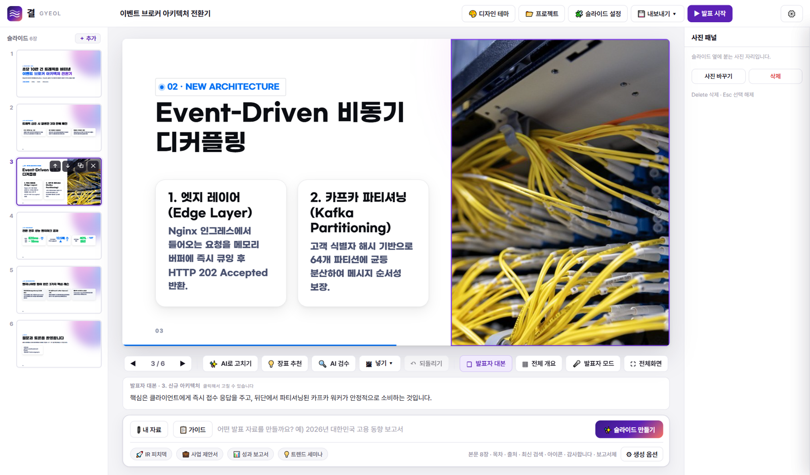
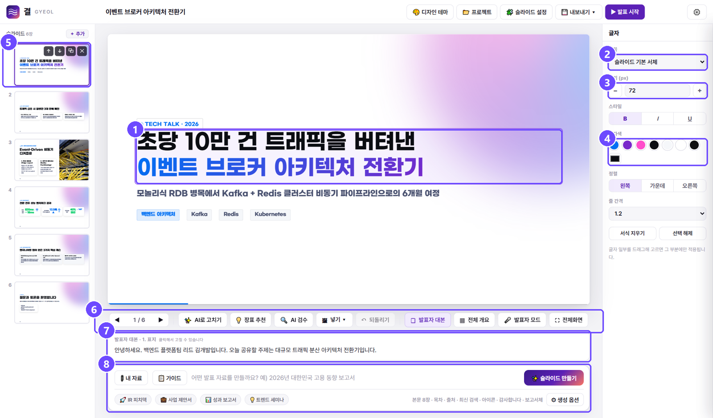
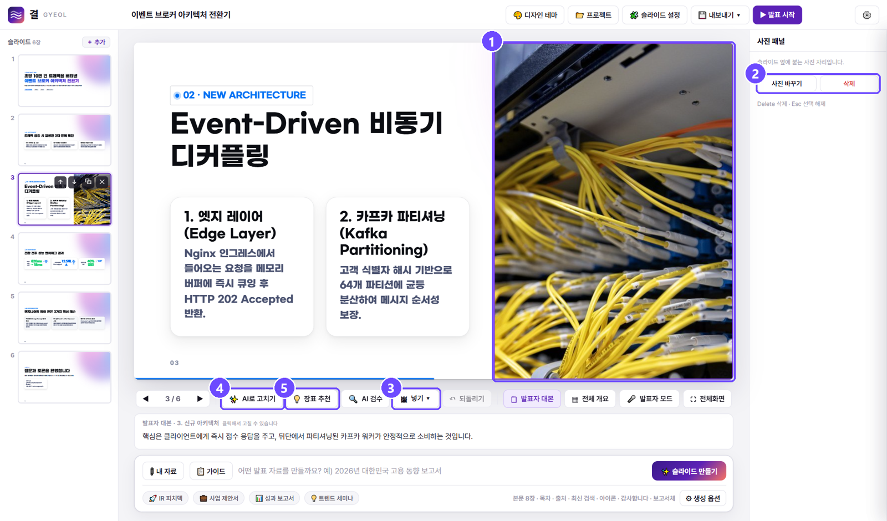
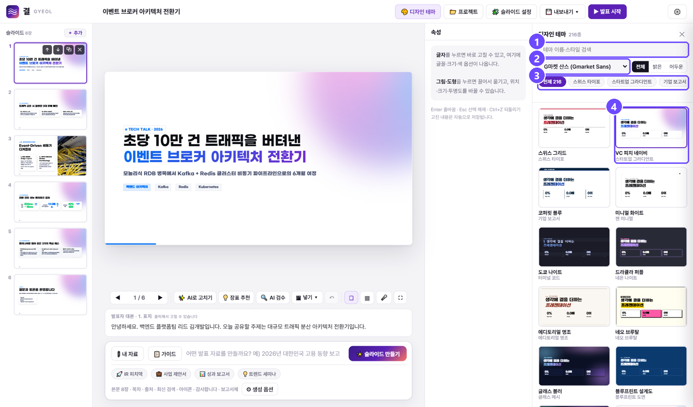
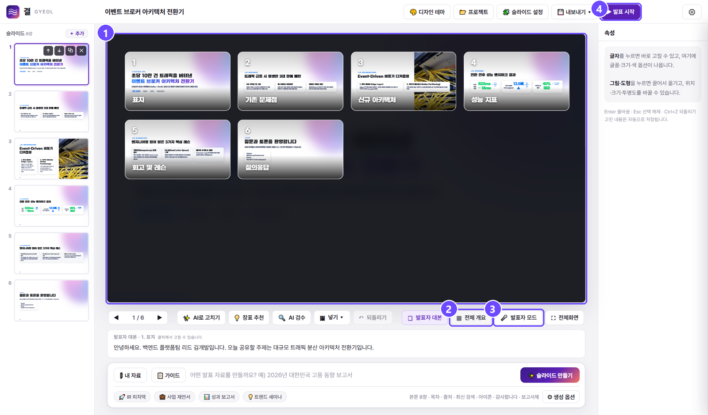
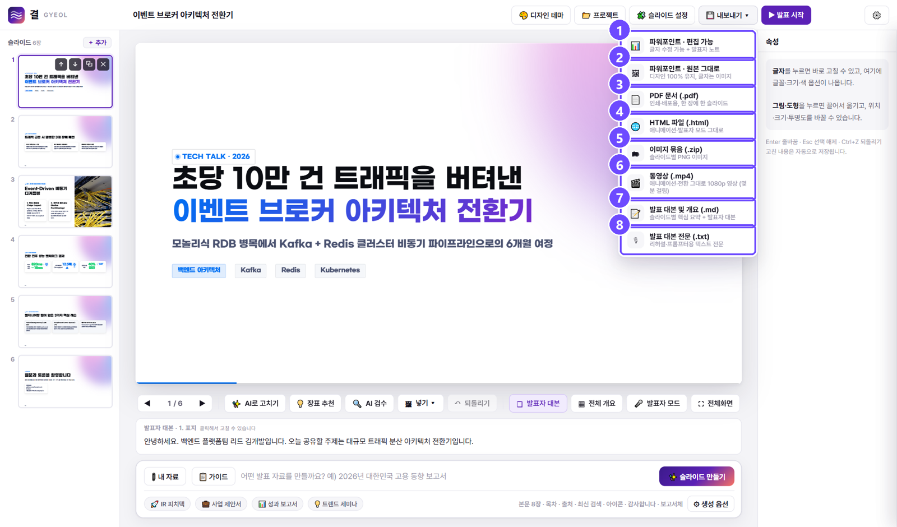
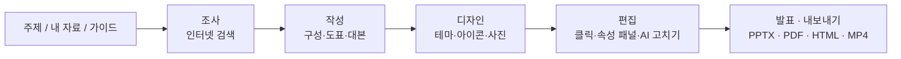
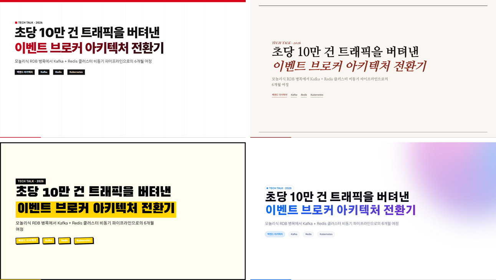

<div align="center">


# 결 GYEOL

**한국어 발표 자료를 만드는 AI 프레젠테이션 프로그램**
주제 한 줄이나 내 파일을 넣으면, 최신 자료를 조사해 디자인된 슬라이드와 발표 대본까지 만들어 줍니다.

[](https://github.com/lsszz2100/gyeol-releases/releases/latest)
[](#-시작하기)
[](#소스로-실행)
[](#-디자인)
[](LICENSE)

[English](README.md) · **한국어**



</div>

---

## ✨ 핵심 기능

| | |
|---|---|
| 🔎 **최신 자료 조사** | 오늘 기준으로 인터넷을 조사한 뒤 슬라이드를 쓰고, 참고 자료 슬라이드를 자동으로 붙입니다. |
| 📎 **내 자료로 만들기** | PDF·Word·파워포인트·한글(HWPX)·엑셀·텍스트·사진을 넣을 수 있습니다. 스캔 문서는 AI가 읽고, **파일 안의 사진도 꺼내 어울리는 슬라이드에 넣습니다.** |
| 📋 **가이드 맞춤 PPT** | 제안요청서나 과제 안내문을 넣으면 요구하는 목차·키워드·문구를 뽑아 그대로 맞춰 쓰고, ✅/⚠️ 점검표로 보여 줍니다. |
| ✍️ **클릭해서 바로 편집** | 글자와 개체를 누르면 바로 고칠 수 있습니다. 오른쪽 속성 패널에서 서체·크기·색·정렬·위치·투명도를 바꾸고, 고친 내용은 자동으로 저장됩니다. |
| 💡 **장표 추천 · AI 검수** | 지금 슬라이드에 어울리는 구성을 추천합니다. 전체 슬라이드에서 글자 넘침·겹침을 찾아 고쳐 줍니다. |
| 🎨 **테마 216종 · 스타일 22종** | 스위스 타이포·에디토리얼 명조·네오 브루탈·글래스·블루프린트·한지 전통 등. 스타일마다 서체·배경·장식이 다릅니다. |
| 🖼 **사진 · 아이콘 · 도형** | 무료 사진 검색, AI 그림, 한글로 찾는 아이콘 200여 개, 도형, 내 사진을 넣을 수 있습니다. |
| 📤 **다양한 내보내기** | 편집 가능한 파워포인트, 원본 그대로 파워포인트, PDF, HTML 한 파일, PNG 묶음, 1080p MP4 동영상, 대본(.md/.txt). |

## 📸 화면 둘러보기

> 아래 견본은 상업용 무료 서체인 **G마켓 산스**(제목)와 **프리텐다드**(본문)로 만들었습니다. 그림 속 번호는 그림 아래 설명 번호와 같습니다.

### 1 · 글자는 누르면 바로 편집



1. **그 자리에서 고치기.** 슬라이드의 글자를 누르고 바로 입력합니다. [편집] 버튼이나 편집 모드가 없습니다. 고른 글자 묶음에는 보라색 테두리가 생깁니다.
2. **글꼴.** 테마 기본 서체를 쓰거나, 상업용 무료 한글 서체 6종(프리텐다드, G마켓 산스, 스포카 한 산스, 조선일보명조, 나눔스퀘어 네오, 배민 주아) 중에서 고릅니다.
3. **크기.** 숫자(px)를 직접 넣거나 −/＋로 조절합니다.
4. **글자색.** 테마 색을 한 번에 고르거나 색상표에서 아무 색이나 고릅니다. 글자 일부만 드래그해서 고르면 그 부분에만 적용됩니다. 굵게·기울임·밑줄·정렬·줄 간격도 같은 방식입니다.
5. **슬라이드 목록.** 끌어서 순서를 바꿉니다. 미리보기마다 위로·아래로·복제·삭제 버튼이 있습니다.
6. **도구 모음.** 이전/다음, ✨ AI로 고치기, 💡 장표 추천, 🔍 AI 검수, 🖼 넣기, 되돌리기, 발표자 대본, 전체 개요, 발표자 모드, 전체화면. 창이 좁아도 한 줄을 유지하고 글자를 줄여 아이콘만 남깁니다.
7. **발표자 대본.** 슬라이드마다 대본이 함께 만들어집니다. 누르면 바로 고칠 수 있습니다.
8. **발표 자료 만들기.** 주제를 쓰고, 📎 내 자료나 📋 가이드를 넣고, 추천 주제를 고르고, ⚙ 생성 옵션(장수·글 분량·도표·사진·마무리 장)을 정한 뒤 ✨를 누릅니다.

고친 내용은 손을 멈추고 1초쯤 뒤 자동으로 저장되고, `Ctrl` + `Z`로 되돌릴 수 있습니다.

### 2 · 사진



1. **사진 칸.** 사진을 누르면 선택됩니다. 자동으로 만든 슬라이드에는 무료 사진, AI 그림, 또는 내 자료 속 사진이 들어갑니다.
2. **사진 바꾸기·삭제.** `Delete`로 지우고 `Esc`로 선택을 풉니다.
3. **🖼 넣기.** 무료 사진 검색, AI 그림, 한글로 찾는 아이콘 200여 개, 도형, 내 사진을 넣습니다. 넣은 개체는 끌어서 옮기고, 크기·앞뒤 순서·투명도를 바꿀 수 있습니다.
4. **✨ AI로 고치기.** 한 줄 요청으로 이 슬라이드만 다시 쓰거나, 뒤에 새 슬라이드를 추가합니다.
5. **💡 장표 추천.** 이 슬라이드 내용에 어울리는 구성·도식·꾸밈을 추천합니다.

### 3 · 디자인 테마



1. **검색.** 테마 이름이나 스타일로 찾습니다.
2. **전체 서체.** 발표 자료 전체의 서체를 한 번에 바꿉니다.
3. **스타일 거르기.** 22가지 스타일(스위스 타이포, 스타트업 그라디언트, 기업 보고서, 에디토리얼 명조, 네오 브루탈, 터미널, 한지 등)과 밝은/어두운 테마로 거릅니다.
4. **테마 카드.** 누르면 바로 바뀝니다. 글자·사진·고친 내용은 그대로 남습니다.

### 4 · 전체 개요와 발표



1. **전체 개요.** 모든 슬라이드를 제목과 함께 한눈에 봅니다. 누르면 그 장으로 갑니다.
2. 여기를 누르거나 `O` 키로 켜고 끕니다.
3. **발표자 모드**(`S`). 대본·타이머·다음 슬라이드가 보이는 창이 따로 열립니다.
4. **▶ 발표 시작.** 애니메이션·전환 효과와 함께 전체화면으로 발표합니다.

### 5 · 내보내기



1. **파워포인트, 편집 가능.** 글자를 고칠 수 있는 진짜 글상자로 만들고, 대본은 발표자 노트에 넣습니다.
2. **파워포인트, 원본 그대로.** 슬라이드를 그림으로 넣어 디자인이 100% 똑같습니다.
3. **PDF.** 인쇄·배포용으로 한 쪽에 한 장씩 담습니다.
4. **HTML.** 파일 하나로 애니메이션과 발표자 모드까지 그대로 됩니다.
5. **PNG 묶음.** 슬라이드마다 이미지 한 장씩 zip으로 묶습니다.
6. **MP4 동영상.** 애니메이션·전환을 살린 1080p 영상입니다.
7. **대본과 개요(.md).** 슬라이드별 핵심 요약과 대본입니다.
8. **대본 전문(.txt).** 리허설이나 프롬프터용입니다.

내보낼 때 서체를 함께 넣어서 다른 PC에서 열어도 똑같이 보입니다.

## 🚀 시작하기

### 설치 (권장)

**[릴리스 페이지](https://github.com/lsszz2100/gyeol-releases/releases/latest)**에서 최신 설치 파일을 받으세요. 새 버전이 나오면 자동으로 업데이트됩니다.

### 소스로 실행

```bash
pip install -r requirements.txt
python -m playwright install chromium   # Edge·Chrome이 없을 때만 (내보내기용)
python app.py                           # 윈도우는 run.bat 더블클릭
```

### AI 연결

⚙️ **설정**에서 하나를 고르세요.

- **Gemini API 키**(권장): 구글 검색 조사, 스캔 문서 읽기, 사진 설명까지 됩니다.
- **OpenAI API 키**
- **구독 로그인**: ChatGPT·Claude·Gemini 공식 CLI로 로그인합니다. API 키가 필요 없습니다.

## 🧭 만드는 과정



## 🎨 디자인

<div align="center">

<br><sub>같은 표지를 216종 중 네 가지 테마로</sub>
</div>

- 서체는 모두 상업적으로 무료입니다(Google Fonts OFL, 무료 한글 서체). 내보낼 때 서체를 함께 넣습니다.
- 한글 줄바꿈·자간·행간 안전장치가 있어서 글자가 잘리지 않습니다.

## ⌨️ 단축키

| 키 | 기능 |
|---|---|
| `←` `→` `Space` | 이전 / 다음 슬라이드 |
| `S` | 발표자 창 (대본·타이머·다음 슬라이드) |
| `O` | 전체 개요 |
| `F` | 전체화면 |
| `Ctrl` + `Z` | 되돌리기 |
| `Delete` · 화살표 | 고른 개체 삭제 / 조금씩 옮기기 |
| `Esc` | 선택 해제 / 닫기 |

## 🗂 폴더 구성

```text
app.py              로컬 서버와 API
ai_engine.py        조사·프롬프트 구성·생성
desktop.py          데스크톱 창(pywebview)과 트레이
core/               자료 읽기·사진·내보내기·가이드·장표 추천·검수·업데이트
static/             편집 화면·테마·서체·아이콘
packaging/          설치 파일과 배포 스크립트
```

## 🔒 개인정보와 보안

- 모든 작업은 내 PC에서 실행됩니다. 프로젝트와 사진은 내 컴퓨터의 데이터 폴더에만 저장됩니다.
- 로컬 API는 이 프로그램 화면에서 온, 실행할 때마다 바뀌는 토큰이 있는 요청만 받습니다.
- 파일과 인터넷에서 가져온 글은 자료로만 쓰고 지시로 따르지 않습니다. AI가 만든 HTML은 화면에 보이기 전에 안전하게 정리합니다.

## 📄 라이선스

결은 [MIT 라이선스](LICENSE)로 공개합니다.
함께 들어 있는 서체·아이콘·라이브러리는 각자의 라이선스를 따릅니다. 목록은 [`static/THIRD_PARTY_NOTICES.txt`](static/THIRD_PARTY_NOTICES.txt)에 있습니다.

## 📄 고지

사용 환경과 연결한 AI 서비스에 따라 일부 기능이 다르게 동작할 수 있습니다.
