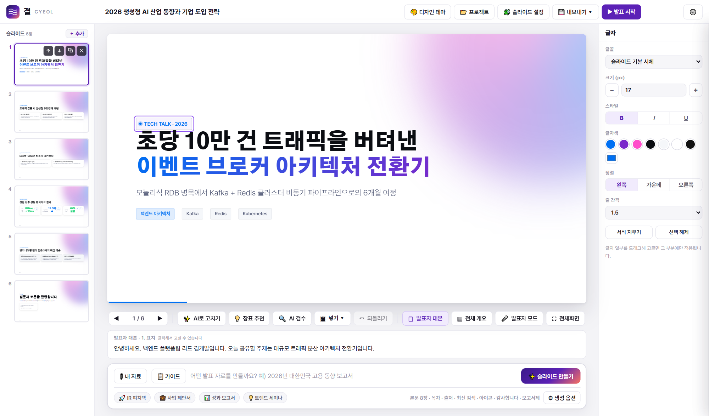
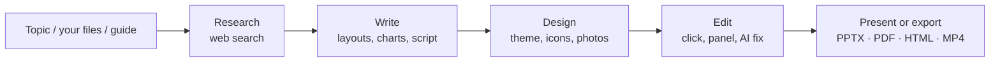

<div align="center">


# GYEOL 결

**An AI presentation studio for Korean decks.**
Type a topic or drop in your files, and get a researched, designed deck with a speaker script.

[](https://github.com/lsszz2100/gyeol-releases/releases/latest)
[](#-getting-started)
[](#run-from-source)
[](#-design)

**English** · [한국어](README.ko.md)



</div>

---

## ✨ Highlights

| | |
|---|---|
| 🔎 **Up-to-date research** | Searches the web as of today, then writes the slides and adds a sources slide automatically. |
| 📎 **Build from your files** | PDF, Word, PowerPoint, HWPX, Excel, text and photos. Scanned pages are read by AI, and **photos inside your files are placed on the slides they fit**. |
| 📋 **Guide-matched decks** | Paste an RFP or assignment brief. GYEOL extracts the required sections, keywords and phrases, writes to them, and shows a ✅/⚠️ checklist. |
| ✍️ **Click to edit** | Every text and object is editable right away. A properties panel on the right gives fonts, size, color, alignment, position and opacity. Changes save automatically. |
| 💡 **Slide advisor and AI review** | Suggests a better layout for the current slide, and checks the whole deck for overflow and overlap, then fixes it. |
| 🎨 **216 themes in 22 styles** | Swiss grid, editorial serif, neo-brutalism, glass, blueprint, hanji and more. Each style has its own type, background and decoration. |
| 🖼 **Images, icons and shapes** | Free stock photo search, AI images, 200+ icons with Korean search, shapes, or your own pictures. |
| 📤 **Export anywhere** | Editable PowerPoint, pixel-perfect PowerPoint, PDF, single-file HTML, PNG set, 1080p MP4, and the script as .md or .txt. |

## 🚀 Getting started

### Install (recommended)

Download the latest installer from **[Releases](https://github.com/lsszz2100/gyeol-releases/releases/latest)**. It updates itself when a new version ships.

### Run from source

```bash
pip install -r requirements.txt
python -m playwright install chromium   # only if neither Edge nor Chrome is installed (export)
python app.py                           # or double-click run.bat on Windows
```

### Connect an AI engine

Open ⚙️ **Settings** and choose one:

- **Gemini API key.** Recommended. Enables Google Search research, scan reading and photo descriptions.
- **OpenAI API key.**
- **Subscription login** with ChatGPT, Claude or Gemini, through their official CLIs. No API key is needed.

## 🧭 How it works



## 🎨 Design

<div align="center">

<br><sub>The same cover in four of the 216 themes</sub>
</div>

- Every font is free for commercial use (Google Fonts OFL and other free Korean fonts). Exports embed the fonts.
- A readability layer keeps Korean line breaks, letter spacing and line height safe, so glyphs are never clipped.

## ⌨️ Shortcuts

| Key | Action |
|---|---|
| `←` `→` `Space` | Previous / next slide |
| `S` | Presenter window: script, timer and next slide |
| `O` | Overview grid |
| `F` | Fullscreen |
| `Ctrl` + `Z` | Undo |
| `Delete` · arrows | Delete or nudge the selected object |
| `Esc` | Deselect / close |

## 🗂 Project layout

```text
app.py              local HTTP server and API
ai_engine.py        research, prompt composition, generation
desktop.py          desktop window (pywebview) and tray
core/               sources, media, export, guide, advisor, review, updater
static/             editor UI, themes, fonts, icons
packaging/          installer and release scripts
```

## 🔒 Privacy and security

- Everything runs on your PC. Projects and pictures stay in your local data folder.
- The local API only accepts requests that carry a per-session token from the app's own origin.
- Text from your files and the web is treated as material, never as instructions. Generated HTML is sanitized before it is shown.

## 📄 Notices

Third-party fonts and libraries are listed in [`static/THIRD_PARTY_NOTICES.txt`](static/THIRD_PARTY_NOTICES.txt).
Features can behave differently depending on your environment and the AI service you connect.
