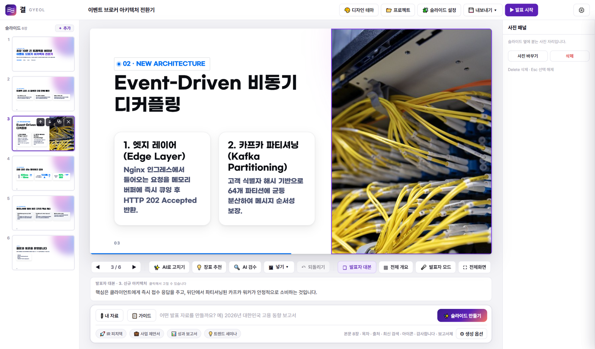
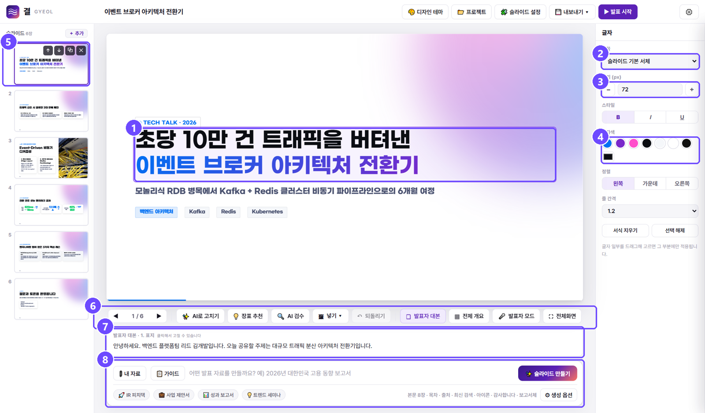
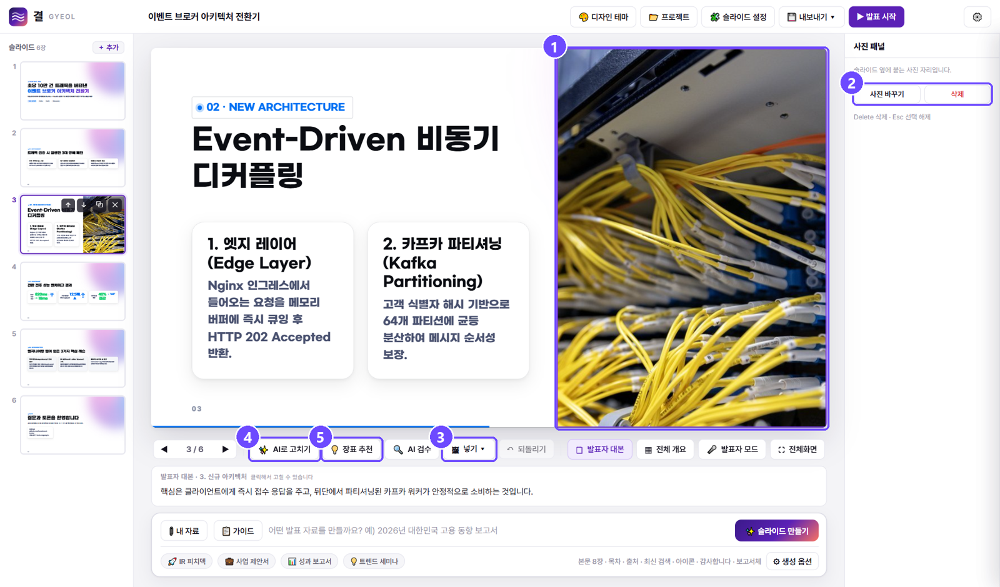
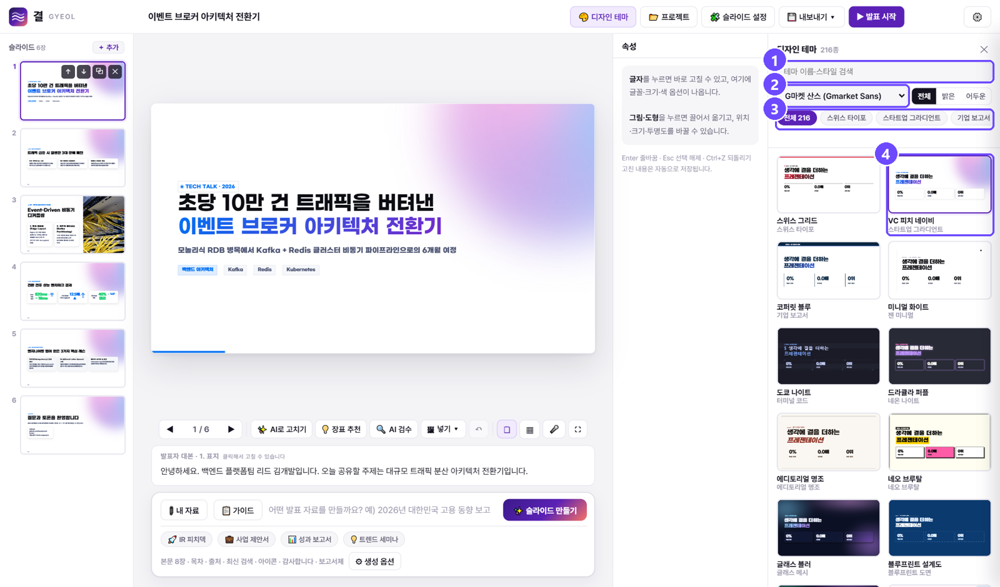
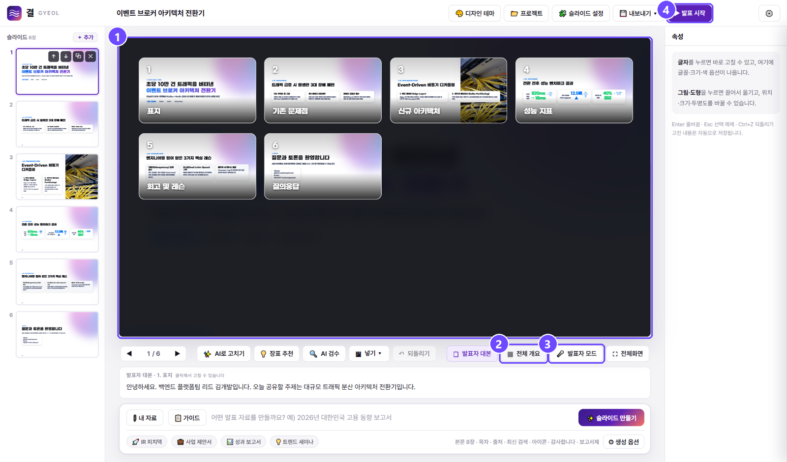
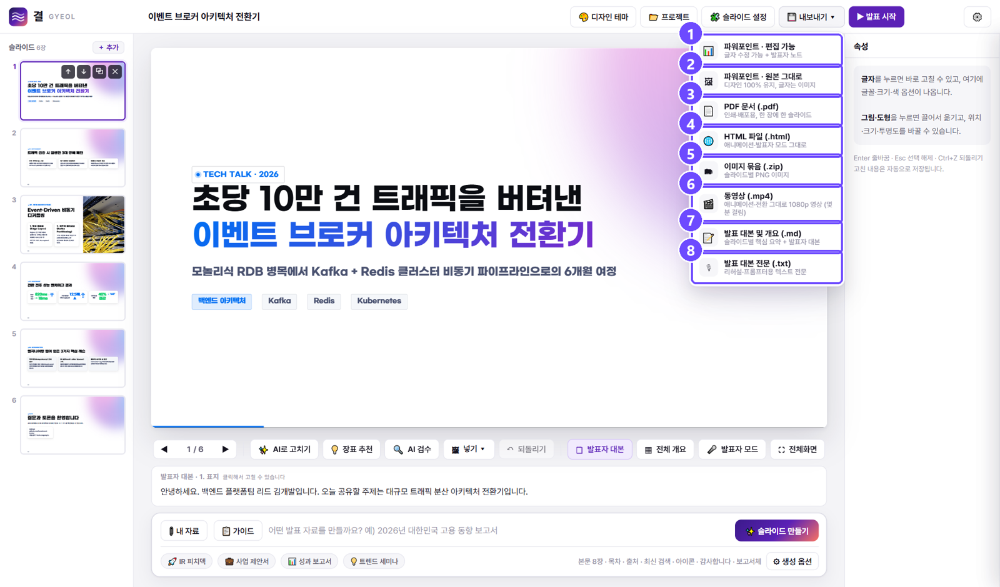
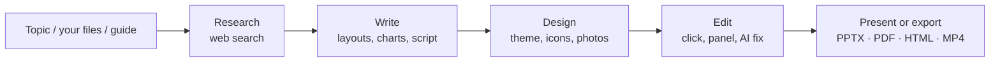
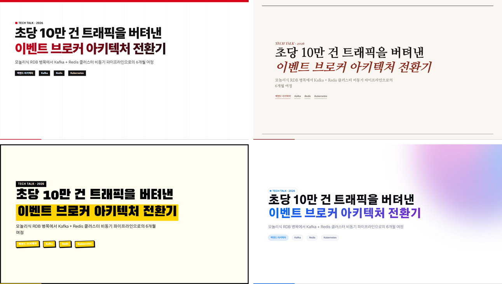

<div align="center">


# GYEOL 결

**An AI presentation studio for Korean decks.**
Type a topic or drop in your files, and get a researched, designed deck with a speaker script.

[](https://github.com/lsszz2100/gyeol-releases/releases/latest)
[](#-getting-started)
[](#run-from-source)
[](#-design)
[](LICENSE)

**English** · [한국어](README.ko.md)



</div>

---

## ✨ Highlights

| | |
|---|---|
| 🔎 **Up-to-date research** | Searches the web as of today, then writes the slides and adds a sources slide automatically. |
| 📎 **Build from your files** | PDF, Word, PowerPoint, HWPX, Excel, text and photos. Scanned pages are read by AI, and **photos inside your files are placed on the slides they fit**. |
| 📋 **Guide-matched decks** | Paste an RFP or assignment brief. GYEOL extracts the required sections, keywords and phrases, writes to them, and shows a ✅/⚠️ checklist. |
| ✍️ **Click to edit** | Every text and object is editable right away. A properties panel on the right gives fonts, size, color, alignment, position and opacity. Changes save automatically. |
| 💡 **Slide advisor and AI review** | Suggests a better layout for the current slide, and checks the whole deck for overflow and overlap, then fixes it. |
| 🎨 **216 themes in 22 styles** | Swiss grid, editorial serif, neo-brutalism, glass, blueprint, hanji and more. Each style has its own type, background and decoration. |
| 🖼 **Images, icons and shapes** | Free stock photo search, AI images, 200+ icons with Korean search, shapes, or your own pictures. |
| 📤 **Export anywhere** | Editable PowerPoint, pixel-perfect PowerPoint, PDF, single-file HTML, PNG set, 1080p MP4, and the script as .md or .txt. |

## 📸 A tour of the editor

> The sample deck below uses **Gmarket Sans** (titles) and **Pretendard** (body), both free for commercial use. Numbers in each picture match the notes under it.

### 1 · Click any text to edit it



1. **Edit in place.** Click any text on the slide and start typing. No edit button or edit mode. The selected block gets a purple frame.
2. **Font.** Keep the theme's font, or pick one of six free-for-commercial-use Korean fonts: Pretendard, Gmarket Sans, Spoqa Han Sans, Chosunilbo Myungjo, NanumSquare Neo and BM Jua.
3. **Size.** Type a pixel size or step it with − / +.
4. **Color.** Theme colors in one click, or any color with the picker. Drag across part of the text first and the change applies only to that part. Bold, italic, underline, alignment and line spacing work the same way.
5. **Slide list.** Drag to reorder. Each thumbnail has move up, move down, duplicate and delete buttons.
6. **Slide toolbar.** Previous/next, ✨ AI fix, 💡 slide advisor, 🔍 AI review, 🖼 insert, undo, speaker script, overview, presenter mode and fullscreen. It stays on one row and drops labels on narrow windows.
7. **Speaker script.** Every slide comes with a script. Click to edit it.
8. **Make a deck.** Type a topic, attach 📎 your files or a 📋 guide, pick a preset, set ⚙ options (slide count, text density, charts, photos, closing slide) and press ✨.

Changes save automatically about a second after you stop. `Ctrl` + `Z` undoes them.

### 2 · Pictures



1. **Photo panel.** Click a picture to select it. Generated decks fill these from free stock photos, AI images or the photos in your own files.
2. **Replace or remove** the picture. `Delete` removes it and `Esc` deselects.
3. **🖼 Insert** free stock photos, AI images, 200+ icons with Korean search, shapes or your own pictures. Inserted objects can be dragged, resized, layered and faded.
4. **✨ AI fix** rewrites only this slide from a one-line request, or adds a new slide after it.
5. **💡 Slide advisor** suggests layouts, diagrams and decorations that fit this slide's content.

### 3 · Themes



1. **Search** themes by name or style.
2. **Deck font.** Change the font for the whole deck at once.
3. **Filter** by 22 styles (Swiss type, startup gradient, corporate report, editorial serif, neo-brutalism, terminal, hanji and more) and by light or dark.
4. **Click a card** to restyle the deck instantly. Text, photos and edits are kept.

### 4 · Overview and presenting



1. **Overview** shows every slide with its title. Click one to jump to it.
2. Toggle the overview here or press `O`.
3. **Presenter mode** (`S`) opens a separate window with the script, a timer and the next slide.
4. **▶ Present** starts fullscreen with animations and transitions.

### 5 · Export



1. **PowerPoint, editable.** Real text boxes you can edit, with the script in the speaker notes.
2. **PowerPoint, exact.** Each slide as a picture, so the design looks 100% the same.
3. **PDF** for printing and sharing, one slide per page.
4. **HTML**, a single file that keeps animations and presenter mode.
5. **PNG set**, one image per slide in a zip.
6. **MP4 video** in 1080p, with animations and transitions.
7. **Script and outline (.md)**: a summary of each slide plus the script.
8. **Full script (.txt)** for rehearsal or a teleprompter.

Fonts are embedded on export, so files look the same on other PCs.

## 🚀 Getting started

### Install (recommended)

Download the latest installer from **[Releases](https://github.com/lsszz2100/gyeol-releases/releases/latest)**. It updates itself when a new version ships.

### Run from source

```bash
pip install -r requirements.txt
python -m playwright install chromium   # only if neither Edge nor Chrome is installed (export)
python app.py                           # or double-click run.bat on Windows
```

### Connect an AI engine

Open ⚙️ **Settings** and choose one:

- **Gemini API key.** Recommended. Enables Google Search research, scan reading and photo descriptions.
- **OpenAI API key.**
- **Subscription login** with ChatGPT, Claude or Gemini, through their official CLIs. No API key is needed.

## 🧭 How it works



## 🎨 Design

<div align="center">

<br><sub>The same cover in four of the 216 themes</sub>
</div>

- Every font is free for commercial use (Google Fonts OFL and other free Korean fonts). Exports embed the fonts.
- A readability layer keeps Korean line breaks, letter spacing and line height safe, so glyphs are never clipped.

## ⌨️ Shortcuts

| Key | Action |
|---|---|
| `←` `→` `Space` | Previous / next slide |
| `S` | Presenter window: script, timer and next slide |
| `O` | Overview grid |
| `F` | Fullscreen |
| `Ctrl` + `Z` | Undo |
| `Delete` · arrows | Delete or nudge the selected object |
| `Esc` | Deselect / close |

## 🗂 Project layout

```text
app.py              local HTTP server and API
ai_engine.py        research, prompt composition, generation
desktop.py          desktop window (pywebview) and tray
core/               sources, media, export, guide, advisor, review, updater
static/             editor UI, themes, fonts, icons
packaging/          installer and release scripts
```

## 🔒 Privacy and security

- Everything runs on your PC. Projects and pictures stay in your local data folder.
- The local API only accepts requests that carry a per-session token from the app's own origin.
- Text from your files and the web is treated as material, never as instructions. Generated HTML is sanitized before it is shown.

## 📄 License

GYEOL is released under the [MIT License](LICENSE).
Bundled fonts, icons and libraries keep their own licenses. See [`static/THIRD_PARTY_NOTICES.txt`](static/THIRD_PARTY_NOTICES.txt).

## 📄 Notices

Features can behave differently depending on your environment and the AI service you connect.
